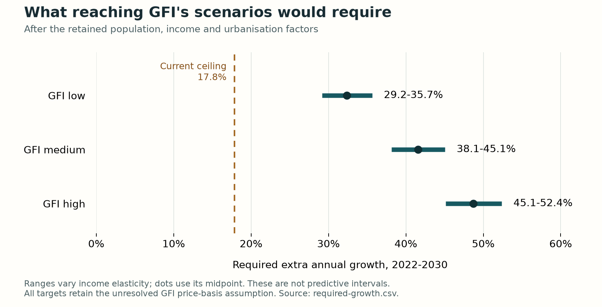

# South Asia writing kit

Prepared for Umar Zafar to write the India–Pakistan regional contribution. This kit supplies section claims, source-linked evidence, caveats, rough replacement paragraphs and questions for the author. It is not a polished report.

The intended reader is an alternative-protein researcher or funder deciding what evidence to pay for first. The proposed priorities are comparable prices, paid repeat purchase and a Pakistan sales baseline. These are author recommendations, not estimated returns.

“Verified” in the companion claim register records the stated agent source or arithmetic check. Human factual and code verification, scholarly assessment and team acceptance remain separate. The joint report PDF is the intended citable version; websites and repositories are companions.

Read the [section map and report word allocation](00-section-map.md), [claim register](claims-by-section.csv) and [conflicts and unresolved items](conflicts.md) alongside this document. Source publication, observation and access dates are distinguished wherever available.

## 1. Executive summary (budget: 600 words)

**Claim:** The immediate funding priority is to establish comparable sales, prices and repeat-purchase evidence before treating conditional market scenarios as an investment forecast.

**Evidence:**

- India's retained middle spending scenario reaches about **$448 million in 2035**, with an assumption-based range of **$166–1,142 million**, in constant **2025 US dollars**. Source: [retained scenario rows](../../../data/altprotein_proxy_scenarios.csv), calculation edition **15 October 2026**, reviewed in the **27 October 2026** methods. Evidence family: conditional model output.
- Pakistan remains in the **low tens of millions at most by 2035** in the reported central range: **$3.6–36.1 million**, at the same price basis. This describes the reported percentiles, not a hard upper limit. Source and dates: the same retained scenario rows. Evidence family: unvalidated transfer scenario without a verified national sales anchor.
- The model starts with GFI India/Deloitte's **2022 estimate of INR 351 crore**. Its converted value, approximately **$45.3 million**, assumes a source price basis and retail valuation that the original summary does not establish. [GFI economic analysis](https://gfi-india.org/wp-content/uploads/2024/06/GFI-India-economic-analysis.pdf), precise publication date unstated; observation year **2022**. Evidence family: external modelled market estimate and conditional conversion.
- Healthy-diet unaffordability is estimated at **40.4% in India** and **60.3% in Pakistan** for **2024**. [SOFI report](https://www.fao.org/fileadmin/templates/cfs/CFS53/Plenary_documents/Inf.15_SOFI_Report/EN_compiled.pdf), published **2025**, Annex A1.6. Evidence family: modelled economic access, not an alternative-product price premium.

**Caveat:** The retained collection does not establish national repeat-purchase series. Missing Pakistan sales evidence is not zero sales. Scenario percentiles are not calibrated probabilities, and low values partly reflect selected growth bounds. Funding measurement first is a proposed learning sequence, not an estimated ranking of returns.

**Cross-reference:** Use the US report for its own forecasting exercise and the Africa report for food-system constraints. Definitions and comparator choices still need the authors' agreement.

**Figures or tables:** The results table in section 6; the paired contrast in section 2. The Pakistan median belongs in Appendix A.

**AI draft, replace:** We examine which observations would make alternative-protein spending paths credible in India and Pakistan. Existing food accounts, household surveys and industry records answer different questions, while the retained market estimates depend on assumptions about growth and transferability. The practical contribution is therefore a sequence of tests: establish a Pakistan sales baseline, measure comparable prices and availability, and observe paid repeat purchasing in familiar meals. The scenarios help identify the assumptions these studies should challenge; they do not establish adoption or displacement.

**Open questions for Umar:** Confirm the funding sequence as an editorial recommendation rather than a demonstrated optimum.

## 2. Question, evidence gap and paired contrast (budget: 800 words)

**Claim:** India and Pakistan provide a useful paired contrast for testing affordability and meal fit, while their protein structures and documented institutions make a common market-growth assumption unsafe.

**Evidence:**

- For **2023**, FAOSTAT reports poultry availability of **3.52 kg/person/year in India** and **8.72 in Pakistan**; pulses **15.39 and 6.53**; milk excluding butter **87.43 and 129.71**, respectively. [FAOSTAT food balances](https://www.fao.org/faostat/en/#data/FBS), release vintage **28 October 2025**. Evidence family: national food supply, not individual intake or preferences.
- India's BioE3 announcement names smart proteins among its aims. [Official Cabinet announcement](https://www.pib.gov.in/PressReleasePage.aspx?PRID=2048568&lang=2&reg=3), **24 August 2024**. Evidence family: policy intent.
- Pakistan's institutional record includes the [Pakistan Halal Authority Act](https://pakistancode.gov.pk/pdffiles/administrator1d376dbb967abb1d9ed2dcb3ae978dbc.pdf), **2016**, and the [Punjab functional-food instrument containing a novel-food provision](https://pfa.gop.pk/wp-content/uploads/2023/05/Punjab_Food_Authority_%28Functional_Food,_Foods_Supplements%29_Regulations,_2025.pdf), notified **27 November 2025**, gazetted **4 September 2026**. Evidence family: dated institutional instruments; no named-product authorization inferred.

| Comparative dimension | India | Pakistan | Question for research |
| --- | --- | --- | --- |
| Familiar alternatives | Pulses, dairy and paneer are relevant comparators for product and meal design. | Poultry and dairy availability motivate product-specific comparators. | Which familiar meal does a named replacement compete with? |
| Purchasing power | Affordability constraints coexist with income and regional variation. | Affordability constraints coexist with income and regional variation. | Does the product fit a household's actual food budget? |
| Policy attention | Retained sources document dedicated smart-protein policy aims. | The retained collection does not identify an equivalent dedicated strategy; halal institutions and Punjab's provision nevertheless exist. | Which steps have reached funding, authorization and market availability? |
| Religious assurance | Relevant populations and product routes differ. | A named product may require halal assurance alongside a separate food-safety route. | What ingredients, process and jurisdiction does the determination cover? |
| Market anchor | A published modelled estimate supplies the retained starting level. | No comparable verified national sales baseline is established in this collection. | What can a baseline study measure consistently? |

**Caveat:** Shared culinary traditions and a broadly comparable income context are study-design reasons for pairing, not proof of equivalent populations. Do not describe India as uniformly vegetarian or infer Pakistani preferences from poultry supply. National units conceal substantial regional, income and religious variation.

**Cross-reference:** The US and Africa chapters can test which constraints recur across very different market and livelihood settings. Similar labels do not make their quantities comparable.

**Figures or tables:** The paired-contrast table above; reuse its qualitative cells in the eventual report, retaining the food-supply values as a separately labelled table.

**AI draft, replace:** The comparison asks how a replacement product would enter an existing meal and budget. Both countries have familiar plant foods and differentiated consumer groups, but the balance of poultry, pulses and dairy differs in the national supply accounts. Their documented policy and assurance routes also differ. These contrasts make the pair useful for designing tests of price, meal fit and institutional access, while arguing against a single regional adoption coefficient.

**Open questions for Umar:** None required for assembly; the exact meal and consumer group belong to subsequent study design.

## 3. The current protein market (budget: 1,800 words)

**Claim:** The existing food system identifies relevant affordability and product comparisons, but no single supply, household or nutrition measure establishes an alternative-protein market.

**Evidence:**

| Evidence family and observation | India | Pakistan | Source and date |
| --- | --- | --- | --- |
| Poultry food supply, kg/person/year | 3.52 | 8.72 | [FAOSTAT](https://www.fao.org/faostat/en/#data/FBS), 2023 observations; 28 October 2025 release |
| Pulses food supply, kg/person/year | 15.39 | 6.53 | Same food-balance release and observation year |
| Milk excluding butter food supply, kg/person/year | 87.43 | 129.71 | Same food-balance release and observation year |
| Unable to afford a healthy diet, percent | 40.4 | 60.3 | [SOFI](https://www.fao.org/fileadmin/templates/cfs/CFS53/Plenary_documents/Inf.15_SOFI_Report/EN_compiled.pdf), 2024 estimates, published 2025 |
| Modelled child stunting, percent | 32.9 | 33.6 | [Joint Child Malnutrition Estimates](https://cdn.who.int/media/docs/default-source/child-growth/child-growth-standards/jme-country-estimates-march2026.xlsx?sfvrsn=65301f6b_3), 2024 estimates, March 2026 release |

- Pakistan's revised HIES table records chicken quantities of **0.17 kg/person/month** in the lowest expenditure quintile and **0.65** in the highest. [HIES quantity table](https://www.pbs.gov.pk/wp-content/uploads/2020/07/TABLE_23-2.xls), survey edition **2024–25**, retained source listed **2025**, precise publication date unresolved. Evidence family: household-reported food quantity converted to a per-person denominator. The gradient is not a price elasticity or a willingness-to-buy estimate.
- India's all-national rural and urban protein estimates are **66.6** and **69.9 g/consumer unit/day**, respectively. [MoSPI Nutritional Intake in India](https://www.mospi.gov.in/sites/default/files/publication_reports/Nutritional_Intake_in_India_L.pdf), **June 2025**, survey period **2023–24**. Evidence family: household nutrient estimates per consumer unit. A consumer unit is based on energy requirements and is not a measured individual's protein intake.
- Bryant and colleagues' Indian sample contained **1,024 online respondents**. [Original article](https://doi.org/10.3389/fsufs.2019.00011), **2019**, participant and limitations sections. Evidence family: selected-sample hypothetical intention; the sample was disproportionately urban, affluent and educated. No Pakistan sample or observed national sales inference follows.

**Material to develop:** Start with the supply comparison, then use household quantities and food-budget definitions to explain why price per usable serving matters. Treat traditional pulses and dairy as existing options. Use food-frequency evidence qualitatively to distinguish frequency from portion size. Explain how the household and nutrition data inform study design without treating deficiency, stunting or a low expenditure group as a ready-made consumer segment. Industry directories and job adverts may indicate where to investigate capacity, but they do not establish output, employment or a national skills shortage.

**Caveat:** Do not join these measures into one dietary ranking. Supply does not measure ingestion; household consumption does not isolate purchases; consumer-unit means cannot identify the prevalence of inadequate individual intake. Stunting has multiple causes and is not a protein-deficiency rate. Pakistan's complete individual protein-intake total remains unavailable in the retained analysis; conditional matched-food subtotals cannot fill it. National aggregation is deliberate here, with regional heterogeneity carried into limitations.

**Cross-reference:** The Africa report's attention to livestock functions and informal markets helps frame what retail measures omit. It does not supply missing Pakistan measurements.

**Figures or tables:** Use the evidence-family table above. Avoid a shared axis for household quantities and consumer-unit protein estimates. The approved kit contains no map or subnational ranking.

**AI draft, replace:** The current food system sets the comparison that an alternative product must meet. National food accounts show different mixes of poultry, pulses and dairy, while household data show that food quantities vary with expenditure. Neither proves a market for an analogue. Nutrition and affordability indicators further caution against treating a technological substitute as automatically accessible or nutritionally adequate. The next empirical step is to measure a specified product against the meal, price and purchasing context it would enter.

**Open questions for Umar:** Decide how much nutrition context is necessary for the funder-facing argument without allowing it to displace the spending question.

## 4. Drivers and obstacles (budget: 2,000 words including AI)

**Claim:** A driver is useful when it identifies a country-specific mechanism and an observation that could challenge it; the current evidence does not estimate a causal ranking.

**Evidence:** The [driver evidence ledger](../../revisions/2026-10-27/data/driver-evidence.json) and [methods](../../revisions/2026-10-27/methods/drivers.md), assembled **27 October 2026**, separate source dates, populations, model treatments and missing evidence. Evidence family: source-grounded organising framework, not estimated effects.

| Driver | Possible increase | Possible constraint | Observable test |
| --- | --- | --- | --- |
| D01 Income | More purchasing power widens feasible purchases. | Extra income can favour conventional foods. | Purchases by defined income group, with macro revisions kept separate. |
| D02 Affordability | A lower price per usable serving supports trial and repeat purchase. | Meat parity need not beat pulses or meet a household budget. | Matched serving prices and paid repeat purchases after discounts end. |
| D03 Dietary practice | A product works in familiar dishes. | Taste, preparation and processing perceptions vary. | Preparation success and repeated meal-specific use. |
| D04 Social legitimacy | Trusted information and familiarity reduce hesitation. | Favourable survey responses may not become purchases. | Separately observed intention, first purchase and repeat purchase. |
| D05 Certification | Product-specific assurance reduces uncertainty. | A general institution does not determine a named product's status. | Ingredient/process-specific assurance and food-authorization records. |
| D06 Public policy | Implemented support develops capabilities. | Announcements may not reach disbursement or usable facilities. | Dated transitions from announcement to implementation and uptake. |
| D07 Capacity and access | Reliable production and distribution improve availability. | Vacancy and directory records do not establish output or skills gaps. | Verified process performance, unit cost and in-stock availability. |
| D08 AI | Technical improvements may lower cost or improve product performance. | Conventional producers may improve too, and savings may not reach prices. | Matched AI/non-AI technical trials and separate retail-price monitoring. |

**Caveat:** Income enters the model explicitly; affordability, legitimacy, certification and policy do not have independently identified coefficients. A residual growth term may contain overlapping mechanisms. The framework does not justify adding another growth bonus.

**Cross-reference:** Use the same driver questions across the three reports, while retaining each report's evidence and outcome definitions.

**Figures or tables:** The driver table above. The full AI module follows this block as a substantial subsection; its budget is included here.

**AI draft, replace:** We organise the evidence around mechanisms that can increase or constrain repeated purchases. The direction of each mechanism depends on product, population and place. Rising income does not guarantee substitution; policy announcements do not guarantee market access; and technical progress does not guarantee a lower retail price. The useful question for funders is therefore which uncertainty a bounded test can resolve and which observable result would change the assessment.

**Open questions for Umar:** None required; final prioritisation remains an author decision.

### AI and relative competitiveness   (within section 4; budget: 1,000 words)

**Claim:** AI could improve alternative-protein production and its conventional competitors; the relevant test is a validated change in their relative costs and product performance, followed separately by evidence of retail pass-through.

**Evidence:**

- **Value and unit: reported experimental method, categorical.** [Cosenza and colleagues](https://doi.org/10.1002/elsc.202300005), published 28 June 2023, studied Bayesian optimization of culture media. Evidence family: laboratory experiment. The retained extraction describes a cellular-agriculture experiment, not cheaper food in either country; the later source review did not recover fresh full text. Use it to motivate a test, not a commercial-cost claim.
- **Value and unit: experimentally tested protein design, categorical.** [Watson and colleagues](https://doi.org/10.1038/s41586-023-06415-8), published 11 July 2023, report designed proteins and experimental testing. Evidence family: laboratory experiment. Expression, food functionality, safety and manufacturing economics remain separate questions. The local literature review also distinguishes structure prediction from manufacturing.
- **Value and unit: policy provision, categorical.** India's [BioE3 approval](https://www.pib.gov.in/PressReleasePage.aspx?PRID=2048568&lang=2&reg=3), dated 24 August 2024, provides for Bio-AI hubs and identifies smart proteins. Evidence family: official policy announcement. This records intent; it does not establish usable facilities, grants, products or sales.
- **Value and unit: research objective, categorical.** The [DBT-BIRAC Smart Proteins call](https://www.birac.nic.in/cfp_view.php?id=98&scheme_type=46), announced 22 February 2025, includes AI monitoring and predictive control of fermentation in its [call text](https://birac.nic.in/webcontent/1743051137_Approved_CFP_Biomanufacturing_Smart_Proteins.pdf). Evidence family: official research call. A call is not a grant-award or performance record.
- **Value and unit: advertised application, categorical and first-party.** [Cell Forge](https://cellforge.in/) described AI-based computational biology and recombinant proteins in the retained observation of 17 October 2026. Publication date unstated. Evidence family: first-party company description. The same observation found its product section marked as forthcoming. Do not infer food approval, sales, deployed scale or cost savings.
- **Value and unit: advertised application, categorical and first-party.** [Cowlar](https://www.dairy.cowlar.com/howItWorks) described machine learning applied to cow monitoring in the retained observation of 17 October 2026. Publication date unstated. Evidence family: first-party company description with a reported Pakistan connection. Current activity and independently measured gains remain unverified.
- **Value and unit: advertised application, categorical and first-party.** [Poulta](https://poulta.com/) described poultry prediction and optimization in the retained observation of 17 October 2026. Publication date unstated. Evidence family: first-party company description. Its inspected address section did not establish Pakistan operations. The Pakistan connection comes separately from an [undated SUN Business Network programme account](https://sunbusinessnetwork.org/stories/alis-out-of-the-box-idea/), also observed 17 October 2026; that account is not an independent evaluation or proof of current operations.

#### Mechanisms to distinguish

| Production route | Mechanism worth testing | Observable result needed | Remaining route to market |
| --- | --- | --- | --- |
| Alternative proteins | Select experiments, improve candidate proteins, monitor fermentation or predict process failures | Replicable performance against a credible non-AI workflow at comparable quality; total cost per usable output | Validate scale, safety, food functionality and reliable supply; then observe selling prices and repeat purchase |
| Conventional dairy | Use monitoring and prediction to inform herd and production management | Validated decisions and cost outcomes against comparable management without the AI component | Separate effects of sensors, staff, practices and automation; establish whether savings change retail competition |
| Conventional poultry | Predict production problems and improve management decisions | Independently checked performance and costs under comparable farm conditions | Verify adoption and sustained operation; measure the resulting price gap faced by replacement foods |

India's retained evidence links biomanufacturing policy to an advertised fermentation application. Pakistan's retained examples chiefly concern conventional dairy and poultry. This is a contrast in the sources available here, not a census of either country's applications or an established ranking of capabilities. It also leaves open whether technical work, ingredient supply, energy, distribution or household purchasing power is the binding constraint for a named product.

#### Signposts and the test attached to R06

| Horizon | Evidence to seek in India and Pakistan separately | Interpretation |
| --- | --- | --- |
| 2026 | A named process, its non-AI comparator, baseline quality and total cost; verified operational status for any company example | Establish the starting point before attributing change to AI |
| 2030 | Independently replicated technical trials, comparable conventional-sector trials, and a record of scale-up costs | Determine whether technical improvements survive outside a demonstration and improve relative competitiveness |
| 2035 | Sustained relative costs, availability and retail prices, with purchase evidence kept separate | Assess whether production gains reached buyers; do not infer national spending from a laboratory result |

These horizons organize proposed observations. They are not predicted delivery dates. R06, linked to D07 and D08, compares an AI-assisted workflow with a credible non-AI workflow, counts compute, labour, validation, failed batches and scale-up costs, and records quality as well as usable output. Retail follow-up is a separate step. The comparator must include improvements in conventional production rather than holding it stationary by assumption.

**Caveat:** The antithesis is that AI improves laboratory work while affordability, market access or trusted product use remains binding, or that conventional producers improve just as quickly. The retained sources establish neither a national AI effect nor its absence. They do not establish that AI is the best use of a funder's next grant. No AI uplift is added to the spending proxy, and cultivated-meat laboratory evidence does not bring cultivated meat into its basket.

**Cross-reference:** Ask the US report which assumptions distinguish technical promise from commercial timing. The Africa report can supply the related warning that new products enter food systems with functions and constraints beyond factory cost. These are general links to dated drafts, not shared findings or pooled effect estimates.

**Figures or tables:** Use the mechanism and signpost tables in `kit/05-ai.md`. No effect-size chart is justified. Source paragraphs: `research/india-pakistan/joint-report/D2-ai-driver.md`, Supporting text and Sources; `research/ai-protein/literature-review.md`, “AI as an intervention and as an incumbent advantage”; and revision `methods/drivers.md`, D08 and R06.

**AI draft, replace:** We should ask which production system benefits from AI under comparable operating conditions. Better experiment selection or process control could help alternative proteins, while monitoring and management tools could also strengthen conventional poultry and dairy. The available country examples are reported applications and policy aims, not demonstrated changes in national food markets. A useful funding decision would identify a specific bottleneck, compare an AI workflow with a credible alternative, and then follow any validated gain through production costs to prices and repeat purchases. The possibility that another constraint remains binding must stay open.

**Open questions for Umar:** Which feasible product and conventional comparator should be the first candidate for R06? This needs a partner and baseline; none is committed.

## 5. Method in brief (budget: 900 words)

**Claim:** The model transparently propagates selected assumptions from an Indian market anchor and transfers the resulting path to Pakistan; it does not estimate adoption from observed purchases.

**Evidence:**

- GFI India/Deloitte's **2022** category estimates are **INR 100 crore meat**, **250 crore dairy** and **1 crore eggs**, totalling **351 crore**. [Original economic summary](https://gfi-india.org/wp-content/uploads/2024/06/GFI-India-economic-analysis.pdf), physical final page; precise publication date and price/valuation basis unstated. Evidence family: externally modelled level.
- The retained calculation converts the total to **$45.286640 million at 2025 prices**, conditional on its valuation assumptions. [Proxy inputs and equations](../../revisions/2026-10-27/methods/proxy.md), explanation dated **27 October 2026**. Evidence family: derived conversion.
- **10,000 draws** of **four parameters** produce the **10th, 50th and 90th percentiles**. The retained lower and upper additional-growth bounds are approximately **−2%** and **17.8%** annually. Source: the same methods and [retained engine](../../../tools/build_altprotein_proxy.py). Evidence family: analyst specification; the bounds use a US retail decline and Indian vacancy growth.

**Plain-language sequence:** Establish the Indian starting level under the stated price assumption. Grow spending per person using real income, urbanisation and an additional growth term. Multiply by population to obtain national spending. Construct Pakistan's path using relative income, urban share, animal-protein supply and industry proxies. Reuse each draw across countries and years. Report how deliberately changing overlapping assumptions changes the result. Detailed equations belong in Appendix A.

**Caveat:** The proxy includes fermentation-derived foods in its intended scope but has no separately estimated category-entry term; its anchor contains plant-based meat, dairy and eggs. Cultivated meat is excluded. Mapping vacancy growth or a US nominal sales decline into a real spending-growth bound is an assumption. The uncertainty range reflects selected distributions and has no demonstrated predictive coverage. The top-down Pakistan check is an independent companion calculation, not an input or a refit.

**Cross-reference:** The US chapter's elicitation method and the Africa chapter's qualitative proxy method remain distinct. Shared labels do not establish a shared estimand.

**Figures or tables:** Reuse the plain-language sequence above; place exact equations and the retained input ledger in Appendix A.

**AI draft, replace:** We start from an external estimate of India's market and make the assumptions needed to carry it forward explicit. The Pakistani estimate is a further transfer because the retained collection provides no comparable national sales anchor. Repeating the calculation under different parameters shows what the chosen assumptions permit. It does not turn those assumptions into observed relationships or assign calibrated probabilities to future sales.

**Open questions for Umar:** The unresolved Indian source price and retail basis must stay visible in the final prose and shared definitions box.

## 6. Results (budget: 1,100 words)

**Claim:** The scenario outputs are useful for exposing assumptions and measurement needs, with greater uncertainty in Pakistan's transferred path.

**Evidence:** All amounts below are **million US dollars at constant 2025 prices**, conditional on the retained source interpretation. Lower and upper mean the **10th and 90th percentiles** of the chosen draws. Source: [retained outputs](../../../data/altprotein_proxy_scenarios.csv), calculation edition **15 October 2026**, methods review **27 October 2026**. Evidence family: conditional scenarios.

| Country | Year | Lower | Middle | Upper |
| --- | ---: | ---: | ---: | ---: |
| India | 2026 | 69 | 93 | 125 |
| India | 2030 | 102 | 188 | 334 |
| India | 2035 | 166 | 448 | 1,142 |

Pakistan's body presentation is **low tens of millions at most by 2035**, with a reported range of **$3.6–36.1 million**. It is a central scenario range, not a maximum possible market. Intermediate-year ranges and medians are reserved for Appendix A. Appendix A's scale check finds that, under central conversion assumptions, the transferred 2035 range equals about 0.012% to 0.125% of Pakistan's conventional poultry and milk value.

- India's **2035** middle result is approximately **$0.28/person/year**, or **1.22%** of the fixed US **2025** benchmark of **$23.106847/person/year**. The US product basket is broader. [GFI US retail source](https://gfi.org/marketresearch/), observation year **2025**, retained capture **15 October 2026**; the ratio is a derived per-person comparison, not a total-market share or a forecast-year comparison.
- An overlap sensitivity lowers India's **2035** middle scenario to **$215 million**. The corresponding **2030** middle changes from **$188 million** to **$120 million**. Source: retained outputs and [GFI sensitivity table](../../../build/gfi-gap/sensitivity-summary.csv), **27 October 2026**. Evidence family: diagnostic sensitivity, not a fitted correction.
- A separate exploratory appendix retains **60 accepted AI responses** and explicitly documents its departure from the **13 October 2026** team decision; it is not headline evidence or independent corroboration.

**Caveat:** The bounds and transfer construction can explain low outputs without establishing that the real market will be small. Do not translate spending into animals, individual adoption or displacement. Do not replace the fixed US benchmark with Anna's medians until the authors agree the comparison and definitions.

**Cross-reference:** The US report offers a separately authored forecasting exercise. Appendix B explains the distinct exploratory supplement and its shared source conditioning.

**Figures or tables:** The India table above. Appendix A holds the transferred medians, sensitivities and the Pakistan conventional-value scale check.

**AI draft, replace:** The reported paths show how selected growth and transfer assumptions combine. They should be read alongside the sensitivities, since plausible concerns about overlapping proxies materially change the middle results. Pakistan's estimate has an additional weakness: no retained national sales baseline checks the transfer. This motivates a baseline study and a transparent external scale check before finer numerical claims are made.

**Open questions for Umar:** Decide whether the one-sentence pointer to the Appendix A scale check is enough in the body.

## 7. GFI India's baseline and growth conditions   (budget: 1,200 words)

**Claim:** We accept GFI India and Deloitte's 2022 market estimate as the retained Indian starting level, while examining separately whether the conditions needed for their forward growth scenarios will occur. Acceptance of that source-based anchor is not independent validation of its measurement, price basis or growth path.

**Evidence:**

- **INR 351 crore in 2022**, comprising plant-based meat at **100 crore**, dairy at **250 crore** and eggs at **1 crore**. Source: [GFI India and Deloitte, Smart Protein Economic Analysis](https://gfi-india.org/wp-content/uploads/2024/06/GFI-India-economic-analysis.pdf), domestic-market table; observation context 2022, precise publication date unstated. Evidence family: published modelled market estimate. The fermentation baseline is a dash, not an observed zero.
- **INR 7,475 crore, 12,779 crore and 18,963 crore in 2030**, the source's low, medium and high domestic cases. Same source and date limit; evidence family: external conditional scenarios. Their method names socioeconomic-group penetration, adoption, replacement, relative prices, taste and price parity, localization, research and talent. Its public summary does not disclose enough numerical assumptions to reproduce the growth path.
- **$187.8 million**, the retained India 2030 median; **$202.2 million**, the paired result when the additional-growth floor moves from **−2% to 0%**; and **$462.0 million**, the analytical maximum within the original bounds. Source: [retained diagnostics](../../../build/gfi-gap/REPORT.md), dated 27 October 2026. Unit: million US dollars at constant 2025 prices. Evidence family: model output and diagnostic sensitivities. The US also supplies the elasticity ceiling, so changing the floor does not remove all US influence.
- **$964.4 million**, the conditionally converted GFI low case, using the retained assumption that the source amounts share a 2022 price basis, adjusted to 2025 prices and exchange rate. Same diagnostic source and date. Evidence family: conditional currency/price conversion. Original source rupee amounts remain essential because neither source price basis nor retail valuation is established.

| GFI domestic case | Source 2030 value, INR crore | Additional annual growth the retained equation would require |
| --- | ---: | ---: |
| Low | 7,475 | 29.2–35.7% |
| Medium | 12,779 | 38.1–45.1% |
| High | 18,963 | 45.1–52.4% |

The ranges come from the [inverse-model calculation](../../../build/gfi-gap/required-growth.csv), dated 27 October 2026; their unit is percent additional growth per year, varying income elasticity across its retained bounds. They are not predictive intervals or total market growth rates. The retained additional-growth ceiling is **17.8%**. Original source growth cannot be labelled nominal or real while its price basis remains unresolved.

The relevant distinction is between a source-based level and the mechanism producing later expansion. GFI's category approach makes parity, penetration and category development explicit. Our aggregate proxy has no separately identified price-parity or category-entry term, although its residual growth term may reflect some of those processes. Its chosen bounds rule out the converted low target. This fact explains the model's permitted range; it does not decide which account will prove more accurate.

**Caveat:** The antithesis is that our proxy's restrictive bounds and omitted mechanisms produce the discrepancy. Rejecting GFI's growth path because it lies outside those bounds would be circular. Conversely, accepting its starting level does not require accepting every later growth condition. The proxy and the regional elicitation share GFI evidence, so neither comparison supplies independent corroboration. Older sector optimism remains an untested explanation of GFI's assumptions; dated sources also record slowing growth. Differences in baskets, scenarios and valuation must accompany any numerical comparison.

**Cross-reference:** Use the US report for a general discussion of how recent sales and assumed technical progress alter outlooks, pending its author's review. Do not pool its outputs with the regional proxy or treat the Africa report as a numerical forecast.

**Figures or tables:** Reuse the existing [required-growth figure](../../revisions/2026-10-27/report/figures/gfi-required-growth.png). The table above derives from `research/india-pakistan/build/gfi-gap/target-comparison.csv` and `required-growth.csv`. Source paragraphs: revision `methods/gfi-gap.md`, “Compare the same question first,” “Category decomposition” and “Four questions raised by the comparison”; original GFI summary, Methodology and domestic-market table.

**AI draft, replace:** We retain GFI India's starting estimate and ask a separate question about what would make its subsequent growth credible. Its scenarios describe category expansion under assumptions about prices, taste and supply capabilities. Our aggregate proxy cannot identify those mechanisms separately, and its chosen growth bounds exclude the low GFI target under the retained conversion. The comparison therefore points to evidence to collect, especially matched prices and sustained purchases. It does not validate our lower trajectory or justify describing GFI's estimates as mistaken. The price and valuation definitions should be clarified before presenting the converted values as a fully matched comparison.

**Open questions for Umar:** After Nadja and Liliia agree, offer GFI India sight of this comparison and request clarification of valuation, price basis and scenario conditions. The accompanying note remains unsent.

## 8. Halal, certification and cultivated access (budget: 1,400 words)

**Claim:** Religious permissibility, product certification, food authorization and consumer acceptance are separate conditions that must be assessed for the named product and jurisdiction.

**Evidence:**

- The [International Islamic Fiqh Academy resolution](https://iifa-aifi.org/en/56085.html), **2025**, sets conditions concerning the donor, culture inputs and credible specialist oversight. Evidence family: dated religious institutional determination; it is not certification of a manufacturer's product.
- [MUIS cultivated-meat guidance](https://www.muis.gov.sg/resources/media-releases/3-feb-24-fatwa-on-cultivated-meat/), **3 February 2024**, addresses a halal animal cell source, halal ingredients and a clean, non-toxic product. Evidence family: dated guidance within Singapore's religious framework; no Pakistan food authorization follows.
- The [Pakistan Halal Authority Act](https://pakistancode.gov.pk/pdffiles/administrator1d376dbb967abb1d9ed2dcb3ae978dbc.pdf), **2016**, establishes institutional provisions. The [Punjab functional-food instrument](https://pfa.gop.pk/wp-content/uploads/2023/05/Punjab_Food_Authority_%28Functional_Food,_Foods_Supplements%29_Regulations,_2025.pdf), notified **27 November 2025** and gazetted **4 September 2026**, includes a novel-food provision. Evidence family: dated institutional text. These sources do not identify a cultivated-specific national approval.

| Question | Evidence needed | Invalid shortcut |
| --- | --- | --- |
| Religious assessment | Complete donor, cell-bank, medium, ingredient and process dossier interpreted by qualified authorities. | Treating a general conditional ruling as certification of every product. |
| Certification | A named certifier's determination, its scope and the applicable product/process revision. | Inferring certification from the existence of a national halal body. |
| Food authorization | The responsible jurisdiction's applicable route and product decision. | Treating an application, consultation or foreign permission as local approval. |
| Consumer response | Paid trial and repeat purchase under a stated assurance and price. | Assuming permissibility guarantees acceptance. |

**Material to develop:** Explain why a founder cell line, earlier banking stages and later production biomass are distinct evidential questions. A serum-free production claim does not resolve the full history of inputs. Separate ingredient residues, washing, biological growth and scholarly concepts of transformation rather than treating them as interchangeable. Use the halal workstream for its process questions and source-specific limits, not as an adoption model. For fermentation, start from the specified organism, feedstock, processing aids and product; do not transfer a cultivated-meat ruling automatically.

**Caveat:** These are retained, dated sources and research questions, not a current legal opinion or a scholarly ruling by the report author. Interpretive and product-specific gaps remain. Cultivated meat stays outside the spending scenarios; the discussion explains an access condition rather than adding market value.

**Cross-reference:** The US and Africa chapters may discuss different authorization and social-legitimacy conditions. Do not imply that a common technology creates a common regulatory or religious route.

**Figures or tables:** Use the decision-separation table above. Refer to the retained halal dossier for a process-specific figure if Umar chooses one; no generic approval diagram is supplied.

**AI draft, replace:** Halal access is a sequence of product-specific evidential questions. General institutions and conditional guidance help identify the questions but do not settle a manufacturer's status. Religious assurance must also be distinguished from food authorization and from consumers' willingness to buy at the offered price. The report can therefore specify the documentation and decisions needed before a pilot, while leaving unresolved interpretations and permissions explicit.

**Open questions for Umar:** Identify a qualified reviewer for any final product-specific religious or legal interpretation; no such sign-off is claimed here.

## 9. Links to the US and Africa reports (budget: 700 words)

**Claim:** A common driver matrix can support the overview while keeping the regional methods, product baskets and evidential strength distinct.

**Evidence:** Anna's US draft snapshot (workspace file: `OUTPUTS/Codex Handoff 2026-10-30/inputs/anna-report-2026-10-29.md`), read **29 October 2026**, and Rufaro's Africa draft snapshot (workspace file: `OUTPUTS/Codex Handoff 2026-10-30/inputs/rufaro-working-doc-2026-10-27.md`), modified **27 October 2026**, support provisional qualitative cross-references only. Evidence family: collaborator draft descriptions, not final or independently verified findings. Their draft numerical claims are not promoted into this kit's evidence.

| Driver question | US draft cross-reference | South Asia contribution | Africa draft cross-reference |
| --- | --- | --- | --- |
| What price must a product meet? | Discussion of persistent premiums and category variation. | Compare usable servings with chicken, paneer and pulses; test repeat purchase. | Discussion of formal-retail premiums and weaker comparable price evidence elsewhere. |
| What constrains growth? | Recent sales performance and different model rationales. | Selected model bounds, affordability and missing national baseline evidence. | Growing conventional demand and the possibility of supplementation. |
| Who benefits from AI? | Timing and commercial translation differ across the draft's rationales. | Test gains in alternatives against conventional poultry and dairy; measure pass-through separately. | AI is discussed as a possible accelerator within wider food systems. |
| What does the conventional system provide? | A mature retail comparator with category differences. | Familiar meals, pulses, dairy and poultry are relevant alternatives. | Livestock can provide savings, insurance, manure and draught power as well as food. |
| Which institutions matter? | Labelling, political and regulatory context. | Policy implementation and product-specific assurance/authorization. | Just-transition and livelihood questions differ across livestock systems. |
| What would change the assessment? | Matched definitions and future observed sales. | Baselines, comparable prices and paid repeat purchase. | Better price/access evidence and the direction of conventional demand. |

**Caveat:** The overview cannot infer a common quantitative result from different methods. The Africa draft does not supply numerical alternative-protein forecasts. Draft model-factor counts are not causal importance weights. Anna's forecast medians remain a proposed comparator, and no owner's approval is inferred from possessing a snapshot.

**Cross-reference:** Use general references such as “the US report's discussion of price premiums” and “the Africa report's livestock-function analysis.” Avoid unstable section numbering and quotations presented as final.

**Figures or tables:** The matrix above is the proposed overview row set. The separate meeting handout asks the team whether to use it as the overview's structure.

**AI draft, replace:** The regional contributions are most comparable at the level of questions. Each asks how price, product performance, institutions and the existing food system condition change, but their numerical methods and outcomes differ. A shared matrix can show where evidence converges and where it remains absent without pooling forecasts or implying a common adoption rate. The authors should agree definitions before the overview places any spending estimates alongside one another.

**Open questions for Umar:** Obtain the authors' decisions on definitions, US comparator and the matrix before joint incorporation.

## 10. Recommendations and market-entry conditions   (budget: 1,100 words)

**Claim:** Funders should first pay for evidence that can distinguish affordable, repeated purchases from technical promise, with a Pakistan sales baseline as a distinct priority; later technical and market-entry decisions should depend on the resulting observations.

**Evidence:**

- **Value and unit: missing fitted national sales anchor, categorical.** The retained [proxy method](../../revisions/2026-10-27/methods/proxy.md), dated 27 October 2026, transfers India's path to Pakistan without fitting it to Pakistan sales. Evidence family: model specification and bounded evidence gap. An additional transfer calculation cannot supply the missing observation.
- **Value and unit: hypothetical rather than observed repeat purchase, categorical.** [Bryant and colleagues](https://doi.org/10.3389/fsufs.2019.00011), published in 2019, supply selected Indian consumer-intention evidence. Evidence family: consumer survey. The sample does not establish national paid demand or a Pakistan result.
- **Value and unit: conditional growth mechanisms, categorical.** [GFI India and Deloitte](https://gfi-india.org/wp-content/uploads/2024/06/GFI-India-economic-analysis.pdf), using a 2022 baseline with publication date unstated, describe price and taste parity, localization and category penetration. Evidence family: external market scenarios. These mechanisms motivate observations; the source does not establish the best-funded intervention.
- **Value and unit: seven retained proposals, extended by one author-requested baseline proposal.** The [recommendation register](../../revisions/2026-10-27/data/recommendations.csv), dated 27 October 2026, supplies R01–R07. The approved handoff (workspace file: `OUTPUTS/Codex Handoff 2026-10-30/HANDOFF.md`), dated 30 October 2026, adds R08. Evidence family: author proposals, not observed programmes or evaluated returns.

### Proposed research priorities

| Recommendation and drivers | Proposed action and comparator | Measurable outcome | Condition before proceeding |
| --- | --- | --- | --- |
| **R01 Comparable retail audit — D01, D02, D07** | Record matched replacement foods and familiar alternatives at the same outlets and dates; distinguish transaction prices from listings | Price per declared comparable serving, in-stock availability and verified purchases, each reported separately | Confirm access and coverage; record pack size, preparation, promotions and the serving definition |
| **R02 Meal fit and repeat purchase — D02, D03, D04** | Test a named product in a familiar meal against its chosen comparator; separate sensory response, stated intention and paid trial | Paid first purchase and unsubsidized repeat purchase, with preparation acceptability as a separate outcome | Set sampling, primary outcome and decision rule before recruitment; resolve product access and authorization |
| **R03 Fermentation product dossier — D05, D06** | Document the specified ingredient, process, intended use and jurisdiction; seek qualified food-authorization and halal clarification separately | Written applicable requirements, unresolved questions and product-specific decisions | Do not start a sale while required assurance or authorization remains unresolved |
| **R04 India technical trial — D07** | Verify an employer-nominated bottleneck and compare a bounded technical or training intervention with existing performance | Usable output, quality, consistency, throughput and total unit cost | Establish staff, facilities, data access and a cost ceiling; vacancies do not establish the bottleneck |
| **R05 Pakistan feasibility assessment — D07** | Verify a proposed facility's staff, inputs, product need and route to buyers before a process trial | A documented capability assessment; if feasible, product functionality, batch consistency and unit cost | A directory entry is insufficient; do not commit equipment or a programme without a verified baseline |
| **R06 AI and non-AI comparison — D07, D08** | Compare a feasible AI workflow with a credible non-AI workflow and track the conventional competitor separately | Validated quality and usable output, full unit cost, then separately observed retail price or availability | Include compute, labour, validation and scale-up; do not translate a technical gain directly into spending |
| **R07 Policy implementation register — D05, D06** | Follow named instruments from announcement to documented implementation, disbursement, authorization and market outcome | Evidenced stage changes and explicit missing stages | Advance each stage only on its own dated record; retain product and jurisdiction specificity |
| **R08 Establish a Pakistan sales baseline — D01, D02, D07** | Define the replacement-food basket and valuation; obtain deduplicated transaction or audited distributor evidence across a documented coverage frame | A dated, reproducible observed-sales total for the covered frame, its coverage, missing channels and reconciliation checks | Publish a bounded covered-market baseline if national coverage cannot be established; missing sales remain missing, not zero |

Price, repeat purchase and the Pakistan baseline are the proposed first learning priorities. That is an author judgement about the evidence needed for decisions, not an estimated ranking of cost-effectiveness. A price audit without sales data remains a price audit. A sampled sales baseline does not become national simply because its arithmetic is reproducible. Technical trials remain worthwhile when a verified process bottleneck and a feasible comparison exist; they should not be justified solely by a large scenario or directory count.

### Market-entry conditions for firms and investors

| Driver signpost | Conditional entry signal | Evidence that would keep the decision open |
| --- | --- | --- |
| D02 and D03: price and meal fit | Demonstrated price per comparable serving against the relevant paneer, chicken, pulse or dairy dish, alongside acceptable preparation and taste | A promotional price, unmatched serving, different nutritional function or unresolved meal use |
| D04: paid repeat purchase | Repeat transactions after introductory incentives end in the intended customer group | Stated willingness or first trial only; customer acquisition without retained purchases |
| D05 and D06: assurance and authorization | Product-specific requirements are documented and applicable decisions are obtained | A ruling about another ingredient, technology or country; a general institutional mandate |
| D07: supply and access | Reliable stock, usable output and delivered unit cost under ordinary operations | Demonstration batches, unavailable listings or unverified distribution capacity |
| D08: AI economics | Validated net benefit after all implementation costs, compared with a credible non-AI process and a changing conventional competitor | Vendor claims, prediction accuracy alone or savings without retail pass-through evidence |

These are conditions for collecting decision-relevant evidence, not investment advice or return estimates. A universal numerical price threshold is not supported by the retained evidence. The study must pre-specify its comparator and threshold once the product, serving, customer group and baseline are known.

**Caveat:** The antithesis is that another bottleneck makes better market measurement insufficient, while a targeted technical intervention could have greater value. The present evidence does not estimate that trade-off. It supports bounded tests and explicit stopping decisions, not a committed programme, partner, budget or guaranteed impact. Animal translation and displacement measurement remain outside this kit's calculations.

**Cross-reference:** The US contribution can inform discussion of price and product performance; the Africa contribution can test whether proposed measures overlook retail structure or wider livestock functions. Different regions need their own baselines and comparators.

**Figures or tables:** Use the priority and entry-condition tables in `kit/10-recommendations.md`. Source paragraphs: revision `report/chapter.md`, “What follows from the evidence”; `methods/drivers.md`, “Recommendations follow the evidence and its gaps”; and `data/recommendations.csv`. R08 is the approved new author proposal.

**AI draft, replace:** Our immediate funding priorities are observations that the current scenarios cannot provide: comparable prices, repeated paid purchases and an observed Pakistan sales baseline. These would let researchers distinguish a small market from poor measurement and test whether product improvements reach households. Technical trials and certification work should proceed where a named product, feasible partner and clear decision are available. This is a proposed sequence for learning, not a claim that its returns exceed every competing intervention. The resulting evidence should also tell firms when an entry decision is premature.

**Open questions for Umar:** Name a prospective owner for each retained priority and decide the first product/comparator pair. Set thresholds only after checking feasible data and costs.

## 11. Limitations and AI use (budget: 800 words)

**Claim:** The contribution is an auditable conditional analysis whose source, model and workflow limitations remain separate from human verification and team acceptance.

**Evidence:** The [limitations and AI-use record](../../revisions/2026-10-27/report/limitations-and-ai-use.md), dated **27 October 2026**, distinguishes source interpretation, transfer assumptions, extrapolation, elicitation and review status. The corrigendum (workspace file: `OUTPUTS/Codex Handoff 2026-10-22/execution/CURRENT-PROSE-CORRIGENDUM.md`), **22 October 2026**, controls corrected scope and ownership wording. Evidence family: documented methods and workflow disclosures.

**Caveat:** National units obscure regional and social variation. The source set is selective. The Indian valuation basis is assumed, Pakistan lacks a verified national sales anchor in the retained evidence, and proxy multipliers may overlap. Macro continuation beyond the published horizon is an analyst extrapolation. Percentile ranges have no demonstrated predictive coverage. A historical US benchmark differs in both product scope and observation year. No animal, displacement or individual-intake translation is supplied.

**Material to develop:** Record the substantive roles of AI in source discovery, summarisation, code, conditional calculations, elicitation and drafting. Distinguish requested model labels from provider-confirmed identities. Explain that agent verification establishes the checks actually performed; it does not fulfil the programme's requirement for human checking of included AI-produced material. Use the review register to identify who checked each source, transformation and interpretation. Keep reuse rights, factual review, scholarly assessment and joint inclusion separate. The final citable object is the joint report PDF; websites and repositories are companions whose alignment and sharing decisions remain separate.

**Cross-reference:** The shared limitations and AI-use material should retain method-specific disclosures from each contributor rather than replace them with a generic statement.

**Figures or tables:** Use the accompanying claim register as a review aid. Do not put private response text, collaborator comments or raw programme documents into the report.

**AI draft, replace:** AI tools assisted several stages of the research and preparation, including coding, summarisation and drafting. The resulting claims and calculations remain subject to human verification. The scenarios are conditional on a limited source set and selected assumptions, and their ranges do not express calibrated probabilities. The report should state these boundaries alongside its results and retain a dated record of the human checks completed before submission.

**Open questions for Umar:** Complete the human tool/task and factual/code verification records; confirm final sharing and reuse dispositions separately.

## Appendix A. Proxy equations, Pakistan medians and scale check (budget: 800 words)

**Claim:** The complete specification and retained medians allow a reader to inspect the transfer without elevating its precision into a body headline.

**Evidence:** The [proxy methods](../../revisions/2026-10-27/methods/proxy.md), **27 October 2026**, and [reference rows](../../../data/altprotein_proxy_scenarios.csv), calculation edition **15 October 2026**, define the following conditional results in **million US dollars at constant 2025 prices**. Evidence family: model specification and derived scenarios. Lower, median and upper refer to the **10th, 50th and 90th percentiles** of selected draws.

| Pakistan year | Lower | Median | Upper |
| --- | ---: | ---: | ---: |
| 2026 | 1.5 | 3.6 | 6.6 |
| 2030 | 2.3 | 6.0 | 13.7 |
| 2035 | 3.6 | 11.8 | 36.1 |

Dropping Pakistan's relative urban-share and animal-supply multipliers lowers its **2035** median to **$8.3 million**. The original **2035** median is approximately **$0.040/person/year**, or **0.17%** of the fixed US **2025** per-person benchmark. These are diagnostic and denominator-specific quantities, not national observations.

**Equation guide:** Indian spending per person equals the converted anchor per person, multiplied by the real-income index raised to the income elasticity, the urban-share ratio and accumulated additional growth. Pakistan's per-person value equals that Indian value multiplied by the relative-income ratio raised to the same elasticity, the relative urban share, the animal-supply ratio raised to its sampled weight and the sampled industry factor. Multiply each per-person value by its population to obtain national spending. The exact symbols, equations, input rows and seed remain in the linked methods and engine; do not retype rounded parameter values as a new specification.

**Caveat:** The input mappings are assumptions, not fitted causal effects. Beyond the IMF horizon of **2031**, the model extends the last available growth rates; this is not an additional IMF forecast. A reproducible calculation does not validate the transfer.

**Cross-reference:** Use the shared definitions discussion for scope and price basis; retain the regional specification here.

**Figures or tables:** The Pakistan table above and the scale-check table that follows. Keep original data and equations available as companions to the joint PDF.

**AI draft, replace:** The appendix retains the numerical detail needed to audit the regional estimates. Pakistan's medians depend on its transfer multipliers, and the overlap sensitivity shows why these amounts should not be treated as precise national forecasts. The body therefore uses the approved order-of-magnitude presentation, while the exact reference rows remain unchanged and available for review.

**Open questions for Umar:** Scientific acceptance of the transfer assumptions remains separate. The scale check now sits here; consider moving part of the results section's word budget to this appendix.

### Pakistan: conventional-value scale check

**Conditional scale comparison. It shows how large the transferred Pakistan scenarios are relative to conventional poultry and milk value. It does not estimate alternative-protein sales or an observed market share.**

Conventional value multiplies quantity by price and converts at PKR 281.143001173202/USD, the retained 2025 annual-average rate. Poultry uses [OECD-FAO consumption quantities](https://sdmx.oecd.org/public/rest/data/OECD.TAD.ATM,DSD_AGR@DF_OUTLOOK_2025_2034,1.1/IND+PAK.A....?startPeriod=2010&endPeriod=2034&dimensionAtObservation=AllDimensions), ready-to-cook weight, from the outlook published in 2025; the 2034 quantity is carried unchanged into 2035. Milk uses [FAOSTAT](https://www.fao.org/faostat/en/#data/FBS) 2023 food availability for milk excluding butter, held fixed.

Prices come from the [PBS issue of 24 December 2025](https://www.pbs.gov.pk/wp-content/uploads/2020/07/Annex_24.12.2025.pdf), page 3, whose national averages cover an urban-market sample: PKR 424.89/kg of live broiler and PKR 203.51/litre of fresh milk. The live-bird price is divided by an assumed dressed/live yield of 0.70. The milk price is converted with the [FAO INFOODS](https://www.fao.org/fileadmin/templates/food_composition/documents/density_DB_v2_0_01.pdf) whole-liquid-milk density of 1.031 kg/litre. Neither conversion is validated for this national basket.

**Central conversion assumptions; values in US dollars at conditional 2025 reference prices.**

| Comparison year | Conventional poultry and milk value, USD billion | Transfer 10th to 90th percentile, USD million | Transfer range as a share of conventional value |
|---|---:|---:|---:|
| 2026 | 27.9 | 1.47 to 6.62 | 0.005% to 0.024% |
| 2030 | 28.4 | 2.28 to 13.68 | 0.008% to 0.048% |
| 2035 | 28.9 | 3.59 to 36.10 | 0.012% to 0.125% |

Across all 18 combinations of quantity source and price profile, the 2035 share spans 0.003% to 0.137%. The alternatives include fiscal-year 2024 to 2025 Economic Survey quantities and Naheed premium-outlet prices deflated by the 7.1% CPI projection. Higher conventional values give lower shares.

The requested capture shares of 0.05%, 0.1% and 0.5% each exceed the 2026 share under all 18 profiles. Across the full 162-row grid, 139 rows exceed the transfer's 90th percentile and none falls below its 10th percentile. At 0.5%, the milk component alone is USD 112.70 million in 2026, over 17 times the transfer's 90th percentile.

This is a scale check because the baskets differ. Conventional value includes nonmarketed and loose milk at an urban fresh-milk price, while the retained alternative-protein price evidence comes from formal retail. FAOSTAT's milk item excludes the milk equivalent of butter and ghee, listed separately at 1,268 thousand tonnes of food; the Economic Survey's milk for human consumption is 58,300 thousand tonnes against FAOSTAT's 32,104. The live-bird price values poultry below retail. The transfer's basket includes plant-based meat, dairy and eggs; the conventional basket covers poultry and milk only. No retained source gives an observed alternative-protein share of conventional value in either country, so the requested shares remain unanchored.

**AI draft, replace:** We compare Pakistan's transferred scenarios with the value of conventional poultry and milk. Under central conversion assumptions, the scenarios equal about 0.005% to 0.024% of that value in 2026 and 0.012% to 0.125% in 2035. These shares describe scale only. The conventional value includes milk that never passes through formal retail, and its price conversions are assumptions. With no observed share to compare against, the result supports measuring a Pakistan sales baseline before any market share is assumed.

[Full grid](../../../build/pakistan-topdown/pakistan_topdown.csv); [assumptions and reproduction](../../../data/pakistan-topdown/README.md).

## Appendix B. Exploratory elicitation supplement (budget: 450 words)

**Claim:** The separate elicitation documents repeated AI responses and workflow disagreement; its inclusion is a proposed, explicitly disclosed departure from the earlier team decision.

**Evidence:** The [panel methods](../../revisions/2026-10-27/methods/panel-supplement.md), dated **22 October 2026**, report **60 accepted responses** from **79 recorded entries**: **15 rejected**, **3 execution errors** and **1 entry without a recorded command**, in addition to the accepted set. Retained panel data (workspace file: `.worktrees/report-review-20261027/data/panel_runs.json`) and attempt register (workspace file: `.worktrees/report-review-20261027/data/panel-attempts.csv`). Evidence family: exploratory elicited outputs and execution accounting, not independent experts.

The binding interview record (workspace file: `OUTPUTS/Drive Review 2026-10-29/CONSOLIDATION-STRATEGY.md`), **30 October 2026**, requires this appendix to disclose departure from the **13 October 2026** collaboration decision that the Global South sections use proxies rather than LLMs. Inclusion remains a team decision. Anna's study and the supplementary US arm remain separately authored exercises.

**Caveat:** The regional prompts exclude fermentation while the proxy includes it in intended scope. Regional evidence packs included GFI material, so agreement is not independent corroboration. Search parity and requested provider identity are not automatically established by the receipts. Selection, retries and a parser amendment can affect the accepted set. Between-run dispersion is not predictive uncertainty. No pooled median or new model call is added.

**Cross-reference:** Keep a single sentence in the main body and the methods disclosure here. Do not present this as Anna's approved protocol or an accepted joint result.

**Figures or tables:** Use the attempt accounting above; detailed retained numerical summaries remain in the companion. Private prompts and raw response text are not reproduced.

**AI draft, replace:** This supplement records a separately authored exploratory exercise. Its repeated responses reveal stability and disagreement within the recorded workflows, subject to the supplied evidence and acceptance rules. It departs from the earlier team choice to use proxies for the Global South sections and is proposed for appendix treatment only. Its results do not replace the main scenarios, establish calibrated uncertainty or provide independent confirmation.

**Open questions for Umar:** Obtain the team's appendix-only inclusion decision; the heads-up to Anna remains unsent.

## Appendix C. Sources and review trail (budget: 350 words)

**Claim:** Readers should be able to trace each retained numerical statement to its source and transformation without confusing an agent check with human acceptance.

**Evidence:** [Claims by section](claims-by-section.csv), [conflicts and unresolved items](conflicts.md), and [section/source map](00-section-map.md) provide the writing trail. Evidence family: local provenance and review records. Original source links accompany evidence throughout the kit; their source dates are distinguished from observation and access dates.

**Caveat:** “Verified” and “corrected” in the CSV mean the specified agent source/arithmetic checks passed. Human factual/code verification remains pending unless a named human supplies a dated disposition. Unknown publication dates remain unknown. A working link or retained hash does not establish rights, current availability or national representativeness. Draft collaborator snapshots are for cross-reference only.

**Cross-reference:** The joint report should use a common bibliography with hyperlinks after its authors agree the definitions and final text.

**Figures or tables:** Use the CSV as an editing and review aid, not as hidden identifiers in the DOCX. The final joint PDF is the citable version; website and repository materials are companions.

**AI draft, replace:** The source register separates original observations, published model estimates, analyst calculations and proposed tests. It records what each source supports and the limits that remain. Before submission, the author and named reviewers should complete the factual, numerical and code checks and carry unresolved items into the text or omit them. The existence of a reproducible companion does not replace that review.

**Open questions for Umar:** Assign the remaining human review and confirm source-specific reuse requirements before external sharing.

### Source list for bibliography assembly

- FAO, [FAOSTAT Food Balances](https://www.fao.org/faostat/en/#data/FBS).
- FAO and partners, [The State of Food Security and Nutrition in the World](https://www.fao.org/fileadmin/templates/cfs/CFS53/Plenary_documents/Inf.15_SOFI_Report/EN_compiled.pdf).
- UNICEF, WHO and World Bank, [Joint Child Malnutrition Estimates](https://cdn.who.int/media/docs/default-source/child-growth/child-growth-standards/jme-country-estimates-march2026.xlsx?sfvrsn=65301f6b_3).
- Pakistan Bureau of Statistics, [Household Integrated Economic Survey revised quantity table](https://www.pbs.gov.pk/wp-content/uploads/2020/07/TABLE_23-2.xls).
- Government of India, MoSPI, [Nutritional Intake in India](https://www.mospi.gov.in/sites/default/files/publication_reports/Nutritional_Intake_in_India_L.pdf).
- Bryant and colleagues, [A Survey of Consumer Perceptions of Plant-Based and Clean Meat in the USA, India, and China](https://doi.org/10.3389/fsufs.2019.00011).
- GFI India and Deloitte, [Smart Protein Economic Analysis](https://gfi-india.org/wp-content/uploads/2024/06/GFI-India-economic-analysis.pdf).
- GFI, [US retail market data](https://gfi.org/marketresearch/).
- IMF, [World Economic Outlook macroeconomic series](https://www.imf.org/external/datamapper/api/v1/NGDP_RPCH); World Bank, [official exchange-rate series](https://api.worldbank.org/v2/country/PAK/indicator/PA.NUS.FCRF?format=json).
- Government of India, [BioE3 Cabinet approval](https://www.pib.gov.in/PressReleasePage.aspx?PRID=2048568&lang=2&reg=3); DBT-BIRAC, [Smart Proteins research call](https://www.birac.nic.in/cfp_view.php?id=98&scheme_type=46).
- Cosenza and colleagues, [Bayesian optimisation of culture media](https://doi.org/10.1002/elsc.202300005); Watson and colleagues, [protein design and experimental validation](https://doi.org/10.1038/s41586-023-06415-8).
- [Cell Forge](https://cellforge.in/), [Cowlar](https://www.dairy.cowlar.com/howItWorks) and [Poulta](https://poulta.com/), first-party application descriptions; [SUN Business Network account](https://sunbusinessnetwork.org/stories/alis-out-of-the-box-idea/) for Poulta's reported Pakistan connection. These are not independent performance evaluations.
- Pakistan, [Pakistan Halal Authority Act](https://pakistancode.gov.pk/pdffiles/administrator1d376dbb967abb1d9ed2dcb3ae978dbc.pdf); Punjab Food Authority, [functional-food regulations with a novel-food provision](https://pfa.gop.pk/wp-content/uploads/2023/05/Punjab_Food_Authority_%28Functional_Food,_Foods_Supplements%29_Regulations,_2025.pdf).
- International Islamic Fiqh Academy, [cultivated-meat resolution](https://iifa-aifi.org/en/56085.html); MUIS, [cultivated-meat guidance](https://www.muis.gov.sg/resources/media-releases/3-feb-24-fatwa-on-cultivated-meat/).

Dates, exact locators and acceptance limits are attached to their uses above and in the companion CSV. P4's official-price and quantity sources are documented in its box and reproducibility records. The collaborator snapshots are working cross-references and should not be cited as final publications.
